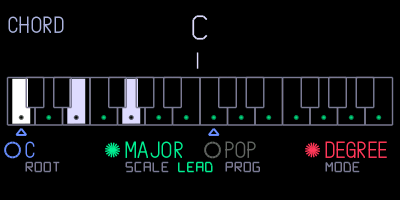

# Changelog

## 3.3.2

Fixes:

- Each tape keeps its own tempo when you restart the OP-1. The tempo is saved as soon as you change it and when you power off, and starting up no longer copies the last tape's tempo onto tape 1. 3.3.1 may have saved some tapes with the wrong tempo: set those once and they stay.
- After a count-in, the metronome level on the tempo screen no longer drops to 0.
- QUANT keeps clicking through a take when the tape is stopped.
- STEFAN keeps each track's position, loop points and speed, and which track is selected, when you restart the OP-1.
- With STEFAN switched off, the tape page no longer shows STEFAN's screen after an update prompt.
- Copying a drum kit with an apostrophe (') in its name or folder over in disk mode no longer crashes the OP-1.
- An OP-1 with full flash starts again instead of stopping before the first screen.
- Letting go of a key no longer does something on a page that didn't see you press it, and pressing DRUM shows the right drum page straight away.
- sampler+ ping-pong loops keep turning when the play position is past the loop end or the loop is very short.
- If the master effect you used has been removed, the OP-1 no longer starts with a wrong master effect selected.
- MOAI's cutoff no longer glitches when it slides down to 0, and a few rare timing faults in punch-in, tape markers and Dots are fixed.
- With PLOC installed, pushing blue on another synth no longer closes page 2 again when you let go, and switching sounds no longer clears another synth's pages.

## 3.3.1

Highlights:

- [Opus plugins](https://hundekraft.github.io/op1-workshop/manual.html#opus): hundekraft now runs plugin files made for Opus as they are. Send your own `.opmod` files from the workshop, or use the bundled ones. LizardMan's dimension, dx, sim, matrix and chorus are ticked from the start, and bitcrush and plate are there to tick. Their settings share one page, [OPUS PLUGINS](https://hundekraft.github.io/op1-workshop/manual.html#settings-opus), at the end of settings. They take the place of the earlier hundekraft DX, HIM, DIMENSION, MATRIX and KHORUS, which are gone from the list, as is KASTLE. castle isn't bundled any more; a castle file you send yourself still loads. Updating removes them from your OP-1. A sound you saved with one of those may sound different or fall back to a stock engine. A plugin with the same name as one of ours gets `_o` after its name. Our own Amp and outatime stay, so Opus's amp and outatime aren't bundled, but a file you send yourself still loads, as amp_o and outatime_o.
- [QUANT](https://hundekraft.github.io/op1-workshop/manual.html#quant): a sequencer that records what you play after a bar of count-in and loops it on the grid. Grid, strength and swing can be changed back at any time, and REC + [Shift] + the high C# puts the loop on tape in time. Add it from the plugin list. The idea is u/Infamous_Call_6492's.
- [Print a MIDI track onto the tape](https://hundekraft.github.io/op1-workshop/manual.html#midiseq-print): [Shift] + [drop] in the MIDI sequencer records the selected track as audio, perfectly in time, then mutes it. The idea is u/Infamous_Call_6492's.
- Restoring a backup of tape 2, 3 or 4 through disk mode no longer crashes the OP-1. Copying the files back used to write every second of silence as well, and that filled the flash. Now only the recorded audio takes space, the restored tape gets its clips back, and tape 1 keeps its own.

Tapes:

- If the flash fills up while you copy in disk mode, the computer gets a write error and the OP-1 keeps running.
- [Last tape at start-up](https://hundekraft.github.io/op1-workshop/manual.html#tapes): the OP-1 comes back on the tape you used last. It opens on tape 1 and switches a few seconds later. The idea is u/Infamous_Call_6492's.
- Hold [Shift] and an arrow on the tape screen and the jump to the next grid line repeats until you let go. The idea is u/Infamous_Call_6492's.
- [Quantized punch](https://hundekraft.github.io/op1-workshop/manual.html#punch): with QUANT PUNCH on, a recording starts on the next grid step after you press REC and stops on a step too. The grid is a bar, 1/4, 1/8 or 1/16. The idea is u/Infamous_Call_6492's.

Sampler:

- [Tune a sample by hand](https://hundekraft.github.io/op1-workshop/manual.html#sampletools): on the synth sampler, hold [Shift] and turn the green encoder for semitones or the white one for cents. The idea is BarneyBrown's.
- [Lazy chop](https://hundekraft.github.io/op1-workshop/manual.html#sampedit-controls) waits for you now: after TAP, nothing plays until you press a key, and that key starts the sample from the top. The idea is BarneyBrown's.

Sequencers and MIDI:

- [Grids starts with the tape](https://hundekraft.github.io/op1-workshop/manual.html#seq-tape): hold REC and press [Shift] + the high C#, as with Euclid and Dots. The idea is u/Infamous_Call_6492's.
- [Scale](https://hundekraft.github.io/op1-workshop/manual.html#scale) and [chord mode](https://hundekraft.github.io/op1-workshop/manual.html#chord) now reach USB MIDI out: with either on, the keys send the notes the synth plays, mapped to the scale and with the whole chord, instead of the keys you pressed.
- [Composer](https://hundekraft.github.io/op1-workshop/manual.html#composer) and [Trail](https://hundekraft.github.io/op1-workshop/manual.html#trail) have new screens. The notes get most of the room, the song's sections sit along the top, and the values at the bottom are bigger, with bars. Trail draws the phrase it's playing in white, with earlier ones fading out behind it.

Sounds and effects:

- [PLOC](https://hundekraft.github.io/op1-workshop/manual.html#ploc): a water synth by Nicolas Franck Pauly. Keys play drops, spray and ripples, and the tap on the screen turns with FLOW. It comes with eight presets and a small companion, PLOCCTRL. Add it from the plugin list.
- [Amp](https://hundekraft.github.io/op1-workshop/manual.html#amp) has two new voices, High Gain and Metal: several gain stages in a row into a 4x12-style cabinet, with a tighter gate. The idea is u/Infamous_Call_6492's.
- [Channel strip](https://hundekraft.github.io/op1-workshop/manual.html#strip): hold [Shift] and push the green encoder to move a strip after the effect (POST FX) and back, without a click. The idea is BarneyBrown's. The strip also has meters in and out, opens with [Shift] + [T2] on the synth, drum and master effect pages, and DRIVE goes further in its top half. A new [MASTER strip](https://hundekraft.github.io/op1-workshop/manual.html#strip-master) works on the whole mix.

Settings and the workshop:

- The workshop's plugin list has a search box and filters by type and by maker.
- [Support the creators](https://hundekraft.github.io/op1-workshop/manual.html#support-creators): a plugin's card has a small coffee cup next to its maker's name that goes to their own Ko-fi or tip page.
- [Picker step](https://hundekraft.github.io/op1-workshop/manual.html#settings): a new PICKER STEP row in settings sets how many encoder clicks move the synth, effect, LFO and sequencer lists and the preset browser one row: 1, 2 or 4. 4 is how it has always been. The idea is u/Infamous_Call_6492's.
- Sharper screens: text and thin lines now land on whole pixels of your OP-1's screen, whichever panel it has, so they don't blur. The screens that looked worst were redrawn too. The idea is u/Infamous_Call_6492's.
- Pop-up messages on the OP-1 no longer turn capital letters into icons or apostrophes into question marks.
- **Add your own** in the Presets section takes DX7 `.syx` banks for dx again. Since dx became LizardMan's file in 3.3.1, the page hadn't seen it and only took `.aif` presets.

## 3.3

Highlights:

- [Presets over USB](https://hundekraft.github.io/op1-workshop/manual.html#presets-usb): with the OP-1 plugged in, the workshop's Presets section shows the synth presets and drum kits on it. Add, replace and delete them from your browser, with no disk mode and no restart. Your own `.aif` files and DX banks go the same way.
- [Key velocity](https://hundekraft.github.io/op1-workshop/manual.html#keyvel) for the original OP-1: the accelerometer feels how hard each key hits the case, so harder hits play louder. It starts off; switch it on in settings. (Hundekraft)
- [Room for 1,024 presets](https://hundekraft.github.io/op1-workshop/manual.html#presets) and 256 drum kits of your own, up from 300 and 34, and the preset list stays quick. Going back to an older version needs a format first.
- [Manage presets on the OP-1](https://hundekraft.github.io/op1-workshop/manual.html#naming): save over a preset, rename it or delete it, right from the preset browser.
- [Channel strips](https://hundekraft.github.io/op1-workshop/manual.html#strip) for the synth and the drums: high-pass, low-pass, an EQ band, drive and level, before the effect. [Each tape track](https://hundekraft.github.io/op1-workshop/manual.html#tape-strips) gets one too, saved with the tape. (Hundekraft)
- [Every synth comes with at least 12 presets](https://hundekraft.github.io/op1-workshop/manual.html#presets), and the workshop sends only the presets for what's in your build.

New synths and drums:

- [DRIFT](https://hundekraft.github.io/op1-workshop/manual.html#drift): a small neural net draws the waveform, and the four knobs move through its sound space. The screen is a landscape made of the waves it draws. (Hundekraft)
- [LUDWIG](https://hundekraft.github.io/op1-workshop/manual.html#ludwig): a piano built from measured recordings of a Yamaha grand. You hear the real hammer attack, then every overtone at its own pitch, so the [tuning](https://hundekraft.github.io/op1-workshop/manual.html#ludwig-tuning) can go anywhere from meantone to stretched. It has a [sustain pedal](https://hundekraft.github.io/op1-workshop/manual.html#ludwig-pedal) too. (Hundekraft; samples from the Salamander Grand Piano V3 by Alexander Holm, CC BY 3.0; screen art by Rackes)
- [PINBOARD](https://hundekraft.github.io/op1-workshop/manual.html#pinboard): a synth you patch with pins, after the EMS VCS3. Two oscillators, noise, a ring modulator, a filter that squeals and a third oscillator that runs slow or at audio rate. Pick one of 64 pin patterns or [wire your own board](https://hundekraft.github.io/op1-workshop/manual.html#pinboard-edit). (Hundekraft)
- [Windwood](https://hundekraft.github.io/op1-workshop/manual.html#windwood): a clarinet made from a reed, air and a tube instead of samples, with growl, flutter-tongue and smooth slurs from note to note. (nvmsocool)

Sounds that changed:

- [JUNI](https://hundekraft.github.io/op1-workshop/manual.html#juni) is voiced like a Juno-106: a brighter filter that sings at the top of RESONANCE, and the 106's chorus. Saved JUNI sounds come out brighter. (After FM-106 by PatttF and KR-106 by Karl LaRocca)
- [JUNI chorus](https://hundekraft.github.io/op1-workshop/manual.html#juni-chorus) gets the same 106 chorus, in stereo.
- [Release times](https://hundekraft.github.io/op1-workshop/manual.html#presets): many of our presets had their release the wrong way round, so pads cut off and basses rang on. That's fixed in the presets of 22 synths.
- [PLATE](https://hundekraft.github.io/op1-workshop/manual.html#plate) has a new plate reverb, with decay up to 20 s. The old one is still there as [CLASSIC](https://hundekraft.github.io/op1-workshop/manual.html#plate-classic), and sounds you saved use it, so they sound the same.
- [Elg](https://hundekraft.github.io/op1-workshop/manual.html#elg) has a new sound: every note is a moose call, with throat, breath, a sub and a slow aurora behind it. The old Elg is still there as [CLASSIC](https://hundekraft.github.io/op1-workshop/manual.html#elg-classic), and sounds you saved open in it.
- [OUTATIME](https://hundekraft.github.io/op1-workshop/manual.html#outatime) has four kinds of drive (warm, hard, tube and fold), and the time circuits show the OP-1's own date and time. Sounds you saved stay warm.
- [REACTOR](https://hundekraft.github.io/op1-workshop/manual.html#reactor) plays two octaves lower, where it sounds best. Saved REACTOR sounds drop too.
- [Oxbow](https://hundekraft.github.io/op1-workshop/manual.html#oxbow) has a new screen: a geometric ox head with a gauge in each corner.

Playing and sequencing:

- [Trigger guard](https://hundekraft.github.io/op1-workshop/manual.html#trigguard): a worn key that bounces plays one note, not two. It's on from the start. (Hundekraft, after an idea by Andromax_sussybaka)
- [HOLD](https://hundekraft.github.io/op1-workshop/manual.html#hold): patterns up to 32 steps, a MULTI mode with four mono tracks, and an octave lock. On the drum page it keeps your pads when you change octave, and transpose changes their pitch.
- [Composer](https://hundekraft.github.io/op1-workshop/manual.html#composer): eleven new styles, five classical and six written for piano, from ragtime to montuno. Its [drums](https://hundekraft.github.io/op1-workshop/manual.html#composer-drums) vary more from song to song.
- [Quad LFO](https://hundekraft.github.io/op1-workshop/manual.html#quad) is laid out like the master LFO and has a new polarity setting: both ways, only up or only down. Phase offset and Lorenz chaos are off the knobs; sounds you saved keep theirs.
- [C64arp](https://hundekraft.github.io/op1-workshop/manual.html#c64arp): RANDOM picks the octave at random too, and the screen is sharper.
- The [metronome's](https://hundekraft.github.io/op1-workshop/manual.html#settings) TICK and WOOD clicks are as loud as the OP-1's own click now. They were about 20 dB quieter.

Sampling:

- [Drum sample editor](https://hundekraft.github.io/op1-workshop/manual.html#sampedit): lazy chop (play the sample and tap keys to slice it across the pads), auto-cut on a beat grid at your tempo, and tuning for one pad or all 24.
- [Granular](https://hundekraft.github.io/op1-workshop/manual.html#granular): pitch and grain shape on the pushes, and a new screen. Grains now stay inside the recording, so saved granular sounds play a little differently.
- [In a room](https://hundekraft.github.io/op1-workshop/manual.html#in-a-room): a synced loop keeps playing at a slower tape speed or tempo, and free loops wrap without a dip and run up to 7.6 s.

Settings, USB and the workshop:

- [USB audio](https://hundekraft.github.io/op1-workshop/manual.html#usb): master only, or master plus the four tracks, taken before or after their faders.
- [Settings](https://hundekraft.github.io/op1-workshop/manual.html#settings): plugins with settings get pages of their own, and the [RANDOMISER](https://hundekraft.github.io/op1-workshop/manual.html#randomiser) page picks what Shift + drop changes.
- [More room for plugins](https://hundekraft.github.io/op1-workshop/manual.html#own-plugins): 5 MB instead of 4. The workshop shows a memory bar for your selection and won't build one that doesn't fit.
- The [firmware file](https://hundekraft.github.io/op1-workshop/manual.html#build) is about 2 MB smaller, so everything you pick fits the OP-1's updater again.
- Presets load faster at boot, and the [resource monitor](https://hundekraft.github.io/op1-workshop/manual.html#monitor) shows how long each boot stage took.
- A [crash screen](https://hundekraft.github.io/op1-workshop/manual.html#troubleshooting): when the firmware stops on an error or locks up, it says what went wrong and which plugin was running, instead of freezing on a blank screen. (op1r's xoza and tencur; kennel port by Hundekraft)

Fixes:

- [Gin](https://hundekraft.github.io/op1-workshop/manual.html#gin) no longer crashes when you change an effect after a restart, and no longer gets stuck on UNAVAILABLE, SAVE RETRY or ERROR. Edits made after a restart are saved.
- [Euclid](https://hundekraft.github.io/op1-workshop/manual.html#euclid), [Dots](https://hundekraft.github.io/op1-workshop/manual.html#dots), [Peal](https://hundekraft.github.io/op1-workshop/manual.html#peal) and [Oracle](https://hundekraft.github.io/op1-workshop/manual.html#oracle) no longer leave notes hanging. Euclid no longer fires on every tick after about half an hour.
- [MIDI sequencer](https://hundekraft.github.io/op1-workshop/manual.html#midiseq): a power cut no longer leaves it freezing the OP-1 at every boot, a read error no longer overwrites your song, and LIFT on a big range no longer loses notes.
- [drum+](https://hundekraft.github.io/op1-workshop/manual.html#drumplus): a note still ringing when you switch kits keeps its own kit's settings.
- [AMP](https://hundekraft.github.io/op1-workshop/manual.html#amp), VOX and SNAP in Ear mode hear the tape the way you do: muted tracks drop out, and each track's volume and pan count.
- The [drum sampler](https://hundekraft.github.io/op1-workshop/manual.html#sampletools) no longer clicks at the start and end of a sample, or when a note is cut short.
- [Drum sample editor](https://hundekraft.github.io/op1-workshop/manual.html#sampedit): trims, fades and undo behave, a dropped sample stops at the next pad, and SEQ, REC or the input close the editor first. (tencur, op1r)
- A shared [sampler+](https://hundekraft.github.io/op1-workshop/manual.html#samplerplus) or [drum+](https://hundekraft.github.io/op1-workshop/manual.html#drumplus) preset with broken values no longer crashes the OP-1.
- The [resource monitor](https://hundekraft.github.io/op1-workshop/manual.html#monitor) no longer freezes the OP-1 when its memory bookkeeping is damaged.
- Scrolling an [FX list](https://hundekraft.github.io/op1-workshop/manual.html#effects) no longer clicks.
- [Help](https://hundekraft.github.io/op1-workshop/manual.html#map)'s fade no longer freezes when nothing else on the screen moves.

From op1r by pcppcp (with fixes by tencur and xoza); In a room by ultralazr; Granular features from displayname808's Granular 0.10.0.

## 3.2.6

- Fixed sampler+ crashing or freezing the OP-1 when it was on synth keys 5 to 8. On keys 2 to 4 its page now shows the right waveform too.

## 3.2.5

- Hotfix: a funky, but not really useful tape screen glitch has been fixed. :)

## 3.2.4

- Line clock now sets the OP-1's tempo. After the OP-1 had been plugged into a computer, a clock on line in was ignored, though the Line clock panel showed the right BPM. RATE also has 1 PPQ now, for clocks that send one pulse a beat.
- Line clock starts off, and it only mutes line in while a clock is actually coming in. Before, it could mute line in with nothing plugged in, so VOX and SNAP heard nothing. To use it, hold Shift on the tempo screen and push blue to pick your clock's RATE.
- The master LFO moved to T4 on the Shift + mixer page, the same layout as op1r. Press T4 again to turn it off or on (that was Shift + T3 in 3.2.3), and T3 to jump to the master effect; T4 from there brings you back.
- Master LFO: + and - now go the whole way. At amount 100, a knob set to zero opens fully on +, where it used to stop halfway.
- The metronome no longer goes through the master effect, so a reverb or delay on the master doesn't smear the click. Push orange on the settings page (Shift + help, T3) to send it through again; FX shows after the sound's name.
- VOX, SNAP and Amp can process the tape: pick Ear as the input and they hear what the tape plays, without the track you're recording to. T2 shows TAPE.
- Latch now catches the notes you're holding when you push orange, so you don't have to play them again. There's also a HOLD mode, where every note you play adds to the ones already sounding (the oldest stops when the voices run out). Press a held key to stop just that note. Orange turns latch on and off; to pick LATCH or HOLD, hold Shift on the envelope page and push green.
- The arrow keys transpose C64arp, Oracle, Dots, Euclid, Grids, Peal, Trail, Hold and Composer while they play, like the OP-1's own sequencers. Changing octave in POLY no longer leaves a note stuck. Your saved patterns stay as written; one you entered with the octave shifted now plays that much higher or lower.
- Quad LFO and master LFO: hold Shift and push an encoder to mute that one LFO. The mute is saved with the sound. A sound saved with a muted quad LFO can stop an older firmware from starting, so unmute first if you go back.
- The master LFO has the two Lorenz waves from the quad LFO.
- ENTE starts with the threshold at 0 dB, so picking it doesn't drop the level. Makeup goes to +24 dB; a sound saved with makeup gets twice as much as before.
- FILTER starts as LP IV, fully open, with drive at 60 and no resonance. Sounds you saved keep their own settings.
- CLOUDS and HAIL no longer make the sound quieter when you switch them on with the mix all the way dry. CLOUDS is about 9 dB louder overall, so sounds saved with it come out louder.
- Stutter on the master effect starts on the beat at PLAY and stays on the grid. Picking Stutter no longer makes the audio hiccup, and its screen is lighter.
- Tape effect: push white and it's synced at once, with the division showing; push again for FREE.
- C64arp has a 1/2 rate, first on the green knob.
- Fixed C64arp: after you edited a table, blue only went between OFF, CUSTOM and RANDOM. CUSTOM now sits between OFF and the chord tables.
- Fixed MOAI: turning DET (Shift + blue) while a chord played could still move AMT and DRIVE.
- Fixed the master effect list opening on FILTER instead of the effect you were using.
- Fixed a crash on the first keys after a restart with Gin in a drum slot.
- The effect page now follows a mode key at once instead of showing the previous effect's screen.

## 3.2.3

- Father's CLASSIC is now a single push of white: push to switch it on, push again to switch it off. No more page to turn.
- VOX and SNAP: pushing blue or green puts both on page 2, so you can set Bands and Hold (Target and Range on SNAP) without pushing twice. Push either one again to go back.
- VOX and SNAP: push white or orange to put that knob back where a new sound starts. That's Response and Air on VOX, Formant and Voices on SNAP.
- Master LFO: hold Shift and turn white to pick the polarity. +- swings the knob both ways, as before; + only goes above where you set it, - only below. (Shift + white used to set the waveform a second time.)
- Master LFO: Shift + T3 on its page turns the whole master LFO off and back on. It stays that way after a restart.
- Fixed MOAI: Shift + blue on the main page could jump to another preset now and then, which put DET back and moved AMT.
- The manual has a new section on starting a sequencer in time with the tape: which ones start from a key, and which need REC + Shift + C#.

## 3.2.2

- Composer names the section it's playing (VERSE, CHORUS or DROP, BRIDGE or BREAK) with a letter for which pass it is, and a row at the bottom shows the song form with the current section underlined.
- REACTOR's plant shakes as the core runs hot: a buzz near critical, then a hard judder when it goes critical, settling once the sound dies away.
- Father has a CLASSIC switch on page 2 (push white). It brings back the brighter, shorter Father from 3.1.4 and earlier.
- Sharper text on Composer, Trail, SNAP, VOX and the other screens that draw their own letters. Letters now sit on whole pixels with strokes at least a pixel wide, and the smallest text is a little bigger and brighter.
- Composer and Trail dim a push or Shift option when it does nothing right now, like undo with nothing to undo, or most of Trail while Answer is on. Undo now covers every setting on the page, and in Trail several turns of one knob undo as one change.
- Trail's Shift page says GATE instead of LENGTH, since that's what it always set, and the Answer push shows ANSWER ON or ANSWER OFF.
- Composer's PUSH STOCK no longer wipes your own pad map when the kit is already STOCK.

## 3.2.1

- Fixed a click in ENTE. With a loud trigger, it ducked almost instantly whatever the attack was set to, so every kick clicked. Now the attack sets how fast the ducking comes in, from 0.1 to 50 ms, and a slower attack ducks smoothly. Sounds with a slow attack may duck a little deeper than before.

## 3.2

New synths:

- VOX: your voice, played on the keys. Sing or talk into the OP–1, hold a chord, and VOX puts your words on those notes. Formant makes your voice bigger or smaller without touching the pitch. (Hundekraft)
- SNAP: pitch correction, from polite to obvious. Turn it down and a shaky note slides into tune; turn it up and every note snaps hard to the key. Hold keys and each one adds another copy of your voice, so one chord makes a small choir. (Hundekraft)
- STRUM: a real acoustic guitar that plays along. A Martin HD28, recorded note by note, strums the right chord for your key in time with the tempo. 28 patterns, from campfire strumming and funk to Travis picking, bossa nova and flamenco. (Hundekraft; guitar samples by Jeff Learman)
- REACTOR: a power plant you play like a synth. Four rods hum in a loop that feeds itself; turn up the heat and it grows, bends and howls, and if the heat wins, the core goes critical. (Hundekraft)
- MOAI: a Minimoog-style synth with 121 sounds. Three oscillators into a ladder filter, for fat basses, singing leads and brassy stabs. (fungiboletus)

New effects:

- RACKVERB: the late-80s studio rack in one effect. Big halls, gated drum rooms, reverse reverbs, flangers and slapback echoes, plus QUAD, a multi-effect that chains EQ, chorus, a rotating speaker, delay and reverb. 316 programs, and an AUTH mode with the grainy sound of the original units. (Hundekraft)
- ENTE: the pump, without the patch cables. It ducks your synth every time the kick hits, from a tape track, the input or a steady beat. A rubber duck on screen gets squashed with every hit. (op1r)

New sequencers and tools:

- COMPOSER: hold a key, get a whole song. Verse, chorus and bridge with proper chord changes, in 32 styles from deep house and drum & bass to bossa nova and film noir. Load it on the drum page too and it plays the drums for the same song, with a groove of its own for every style. Hold Shift for swing, note length, a section lock and jumps between sections. (Hundekraft)
- HOLD: hold keys, get a loop. Every key you hold is written into the loop as it passes: a chord, a line, or a drone that never retriggers. Let go and it keeps playing. (Hundekraft)
- TRAIL: a melody that slowly wanders off. Hold a note and it plays a short phrase in your scale built around one small idea, then develops it while you play over it: moved up a step, turned upside down, played backwards. Character takes it from calm to restless, and Answer turns it into a call-and-response partner that replies to what you play. (Hundekraft)
- Latch keeps notes sounding after you let go. (Hundekraft)
- Line clock follows a pulse on the line-in jack, so the OP–1 can play in time with a modular or a drum machine. (Hundekraft, after Pulse Sync by Volker Junginger / ESC_CODE)
  Careful with modular gear: Eurorack clock and gate outputs are often 5 to 10 V, far hotter than the line input is made for, and can damage it. Use an attenuator or a line-level clock output, and start with the level turned down.
- Master LFO gives you four LFOs that move the master effect's knobs. (Hundekraft, op1r)

Better sound:

- Synth voices run at the speed they were designed for. Parts of 28 synths and effects ran too fast or an octave high; they're right now. Sounds saved with them can change.
- MONOLIT has a new ladder filter, a wider Contour, and Heat that makes the filter sing on its own. Saved MONOLIT sounds can change.
- Every effect starts with only a little effect, so you can scroll through them while you play.
- Input gain for VOX, SNAP and AMP: turn blue on T2 to lift a quiet mic or tame a hot line, from −12 to +24 dB. It's saved for each input.

Playing:

- Chord strums can be much slower, up to half a beat between notes, with Human and Shape on page B.
- The scale view looks like the chord page and shows what each key plays.
- Sampler: Shift + green tunes a sample to its own pitch, and the drum auto-cut is easier to set.
- TAPE has a second page: more play heads (2, 3, dotted or swing), a dry/wet mix, and echoes locked to the tempo from 1/16 to 1/2. Older tape sounds play as before. (op1r)
- The quad LFO gets two chaotic waves, Lorenz x and Lorenz z, and a new LFO type, POND: four species compete in a pond, and their ups and downs move four targets. (op1r)
- Chord mode now has 69 progressions in seven groups (pop, rock, jazz, classic, bass lines, film and world), from La Folia and Pachelbel's canon with its walking bass to Giant Steps and Just the Two of Us. Chords can have their own bass note, as slash chords like G/B, and the bass line walks as written. Shift + white jumps from group to group. (Hundekraft)
- BLOT gets a truer 303 squelch: the filter now follows the TB-303's own, the bass holds steady under the resonance, and accents fade with the decay knob. (op1r)
- A metronome that doesn't clash with your tape: pick TICK, a short tick with no pitch, or WOOD, a woodblock knock, in place of the OP-1's beep. It's on the settings page (Shift + help, then T3), on the orange encoder. (Hundekraft)
- C64ARP has eight more tables: OCTAVE, SUS2, DOM7, DIM7, AUG, ADD9, MIN9 and ALBERTI, a broken chord like a piano's left hand. It can also play the keys you hold in random order: turn blue right past the last table to RANDOM.
- MIDI: separate channels for the keys and for knob changes, knob positions sent back to your controller, and the mixer reachable over MIDI. (op1r)
- FX2 routing works with every master effect, the stock ones too, and a track with its send at 0 stays dry. (op1r, Hundekraft)

Fixes:

- TOMBOLA's balls no longer escape the hexagon and go quiet when you switch between screens, for example with FATHER on the master.
- STUTTER's slices have the right length again.
- SID's interval in sync and ring mode steps in semitones, +0 to +24, so it's easy to set and always in tune. Saved sounds keep their interval.
- Sequencers play drum pads at the pad's own pitch. Euclid, Grids, Dots, COMPOSER and HOLD played each pad sharp, more the further right it sat: the eighth key from the left came out a fifth up.
- Notes from a MIDI keyboard are recorded at the pitch you play, also with the OP-1's octave shifted. Dots, Euclid, Oracle, Peal, Grids, HOLD, TRAIL and C64ARP put them an octave off.

## 3.1.4

- Easier updates. From now on, updates over USB no longer need the op1_246.op1 file, only your OP–1 and a cable. You’ll need the file once more to install 3.1.4 itself.

## 3.1.3

- Fixed clicks and short dropouts in tape recordings, most often in the first 20 seconds of a take or in audio copied to the start of the tape. It mostly happened on units with fragmented or nearly full flash, where saving to flash is slow. The cause was a bug in the original 246 firmware, which can drop recorded audio that hasn't been saved yet, made worse by our tape undo's own flash writes.

## 3.1.2

- Oxbow shows its controls again: each encoder's name and value along the bottom, with its page-2 control beneath, and the art raised above them.
- Sampler+: cutoff and resonance (T2 + Shift) now work straight away; turning them switches the filter on as low-pass.
- Fixed knobs that stopped responding after using the sample editor or a second knob page, then switching sounds.
- Lighter screens for C64arp, Warble and Pew, so every plugin fits again.

## 3.1.1

- Fixed a crash (“out of memory”) when switching screens with a sequencer running, most often with many plugins and presets installed. The OP–1 now has more room for drawing its screens.
- The workshop tells you when a selection is too much for the OP–1 to hold, and won’t build or send it until you untick a plugin or two.

## 3.1

Install the full firmware once (boot menu or the workshop’s full update) and back up your tapes and sounds first. After that, updates go over USB.

New synths and effects:

- MONOLIT, a ladder-filter synth for bass and leads (Hundekraft)
- JUNI and JUNI chorus, an early-80s polysynth and its chorus (Hundekraft)
- SISTER, a cathedral reverb whose tail sings (Hundekraft)
- outatime, a time-travel synth (LizardMan245)
- Bloodmoon, a gothic organ with a haunted bell (Nola Drift / SammiBabe666)
- Hollow Saint, a haunted hurdy-gurdy (SammiBabe666)
- From op1r: Grids and dddd, Steve and blot (pcppcp), Brassophone (nvmsocool), Nostromo (Lewis-Clayton), VAPORA (AiAAAA)

New features:

- Master effect routing, Dots synth locks, Sampler+ play modes (pcppcp, Anthony Berg / op1r)
- Chord mode page B and more scales and key maps (pcppcp / op1r, Hundekraft)
- Amp, a live-input amp with a tuner, and new Resource monitor pages (Hundekraft)
- Presets use the new effects and LFOs more, and the workshop offers a matching preset pack for any selection

Faster and steadier:

- Plugins run from faster memory, so big chords on heavy sounds stay clean
- Many synths and effects need much less CPU and sound the same
- Recording to tape no longer slows the OP-1 (after op1r)
- Fewer save stalls when you turn knobs (pcppcp / op1r)

Changed:

- New screens for Wavetable, JUNI, JUNI chorus and Taffy
- Pew is redesigned with 16 new presets; older Pew sounds play differently
- Father is rebuilt and lighter, with a slightly darker tail
- The Lander game is gone; its memory now speeds up the plugins

Fixes: disk mode ends on eject again, tape recording stops cleanly when flash runs low, room for 63 sampler sounds (move extras past 33 off before going back to 3.0.3), no stuck notes in scale and chord mode, and fixes for Gin, Trail and the sampler tools.

## 3.0.3

- Oxbow: larger two-line control names and values, with the artwork raised to make room. (Hundekraft, based on zvenson’s OberVave)
- C64 arpeggiator: turn orange right to hold notes, like the stock arpeggio; Gate moves to Shift + orange. Turn blue left past Major for TABLE OFF, which plays only the keys you hold. (Hundekraft)

## 3.0.2

- Clouds: reduced processing load for dense textures while preserving the sound, grain count and reverb quality. (Hundekraft optimization; pcppcp / op1r fixed-point port; Mutable Instruments DSP by Émilie Gillet)
- C64 arpeggiator: reduced gate-timing processing overhead without changing note timing. (Hundekraft)

## 3.0.1

- Amp: new optional live-input engine with Volume, Comp, Tone and Drive, plus a T2 tuner. (Hundekraft; workflow inspired by Teenage Engineering’s OP-1 Field)
- EVA: restored the radio beep’s level while keeping the choir level unchanged. (Hundekraft)
- Oxbow: reduced synthesis processing cost and improved arithmetic safety at high resonance; added active control names and values for Cutoff, Env and the pushed Wave, Filter and Drive controls. (Hundekraft, based on zvenson’s OberVave)

## 3.0

New since 2.7.2; earlier features remain included.

- Kennel core: synths, effects and optional tools load from individual plugin files. Every build supports 300 user synth presets. (Hundekraft, built from pcppcp’s op1r)
- EVA: space choir and radio interference, with a key-tracking beep and an orange-push octave selector. (Hundekraft)
- MBIRA: thumb-piano synthesis. (Hundekraft)
- Oxbow: OB-style polysynth with normal OP-1 presets. (Hundekraft, based on zvenson’s OberVave)
- SID: 8580-inspired chip synth. (Hundekraft, based on Hermit’s cRSID)
- Aether: control pitch and volume by tilting the OP-1. (pcppcp / op1r; artwork by DAN76/Rackes)
- Gin: drum synthesis with 24 sounds per kit, A/B morphing, four voices, a full editor and eight factory kits. (SquareWave Studio; libpo32 by Eric Lewis; kits adapted from CNTR RNDM)
- HAIL: granular clouds with secondary controls shown on screen. (Hundekraft, based on Émilie Gillet’s Mutable Instruments Beads)
- STUTTER: beat-synchronised stuttering. (Hundekraft)
- Father: stereo ambience reverb with an optional gate. (Hundekraft DSP; Father concept and visual reference by Reddit creator xylograph)
- Crush, Warble and Plate: distortion, modulation and reverb rebuilt as native plugins. (Maiko Pruett’s designs; Hundekraft implementation)
- C64 arpeggiator: editable pitch tables, per-step dwell and gate. (Hundekraft)
- Randomiser: create sound variations and restore up to six earlier states. (Lewis-Clayton / pcppcp; native port by Hundekraft)
- MIDI Tape: record notes and CCs on four tracks alongside the tape, with first-note auto-start, MIDI-only count-in and take/selection quantisation. CC automation also controls the synth’s knobs. (pcppcp / op1r; native integration by Hundekraft)
- Sampler+: loop crossfades, ping-pong, pitch envelopes, filtering, sync and a sample browser. (pcppcp / op1r)
- Four tapes, each with its own tracks, loop, tempo and album; live merge, loop copy/paste and bounce; seven-step undo with a popup. (Maiko Pruett’s designs; Hundekraft implementation)
- Sampler tools: zoom, tuner with retune, and fitting samples to 1–8 bars. (Maiko Pruett’s designs; Hundekraft implementation)
- FILE and flash check rebuilt for kennel. Recording now uses a stable audio copy to prevent healthy flash blocks being wrongly retired; previously marked blocks remain reserved. (Maiko Pruett’s tool designs; Hundekraft implementation and recording fix)
- Clouds processing improvements, more Reverb headroom, In a room loop crossfades and detailed audio-load monitoring. (pcppcp / op1r; In a room by ultralazr; Mutable Instruments DSP by Émilie Gillet)
- 152 curated synth presets, filtered to your selected engines and effects, with revised sound, envelope, FX and LFO settings. Gin’s kits are separate. (Hundekraft; credited source engines and effects)
- One Update OP–1 flow: review installs, replacements, removals and conflicts; send changed plugins over USB, or include a full firmware upgrade when the core needs updating. First installation still uses the boot menu. (Hundekraft)
- Your own plugins: install .knl or .op1p files, manage saved uploads and installed imports in the same list, and Remove or Undo before sending. Choices and uploaded files persist in this browser. Restart verification checks what actually installed. (Hundekraft)
- Updated manual with readable selection links, current feature screenshots and a guide to building and distributing standalone .knl plugins. Short firmware filenames keep the full configuration ID in the build report. (Hundekraft)
- Lander is an optional full-firmware choice, off by default. (Teenage Engineering game; workshop option by Hundekraft)
- Fixed shared-screen graphics-memory exhaustion when changing sound slots and views; reduced heavy-screen drawing work. Plugin loading checks skip invalid files and preserve a recovery route. (Hundekraft)

## 2.7.2

- Fixed: the OP-1 could stop on an error screen at start-up ("Invalid drum patch … error 12"). In drum+, switching a pad back to gate saved a value the OP-1's own check rejects, so the kit failed to load on the next start. Gate is now saved with a value it accepts, and kits saved with 2.6 to 2.7.1 load again, still on gate.
- Fixed: a sound with an effect or LFO the OP-1 doesn't know no longer stops it on an error screen ("Invalid synth patch … error 22"). An unknown effect plays as the filter and keeps its name, so it comes back on a build that has that effect. If the sound still won't load, its effect and LFO are set to delay and element, both off.
- Stuck on the error screen? Hold COM while you switch the OP-1 on, choose firmware update and install 2.7.2. Your tapes, album and presets stay where they are.

## 2.7.1

- Musica Obscura now comes straight from op1r, which merged ultralazr's modules into its own source, together with op1r's small fixes since then. Everything sounds and works the same.

## 2.7

- New: chord mode. Every key you play becomes a chord in the key and scale you choose, on any synth. It stays off until you switch it on.
  - Open it on the clock screen: press Shift + help, then T4. Press T4 again to close the page.
  - Orange: push to switch chords on or off, turn to choose degree or step mode.
  - Degree mode: each key plays the chord that belongs to it in your scale. Hold Shift for a dominant 7th on that key instead.
  - Step mode: each key press plays the next chord of a progression, and the key you press sets how high it sounds. Shift + a key steps back.
  - Blue: turn to set the root note, push to change the chord colour in degree mode (triad, sus4, sus2, 7th, add9).
  - Green: turn to pick one of 13 scales. Push to choose what out-of-scale keys play: a leading chord into the next scale chord, a passing diminished chord or a borrowed chord. Shift + push switches voice leading on or off.
  - White: turn to pick one of 16 progressions or your own. To record your own, push white in degree mode, play up to 16 chords and push again; it becomes "mine". In degree mode, Shift + push clears it. In step mode, push to start the progression over.
  - Your settings are kept after a restart. MIDI out still sends only the key you pressed.
  - With Maiko's scale mode on, keys snap to the scale before chord mode sees them, so out-of-scale chords don't play.

  
- New: Musica Obscura by ultralazr. Mixtur is a subharmonic organ after Oskar Sala's Mixtur-Trautonium, Arc is Duddell's singing arc lamp from 1899, Palme adds the sympathetic strings of the Ondes Martenot, and In a room loops your sound through a room, like Alvin Lucier's piece. Oracle and Peal are sequencers based on geomancy and English bell ringing. Untick any of the four sounds you don't want in your OP-1's lists.
- Supersaw and FM Bell are 6 dB quieter, like Wavetable and Taffy in 2.6.2, so chords no longer clip the synth mix. Turn the volume up a little if you want the old level back.

## 2.6.2

- Wavetable and Taffy are quieter, so chords no longer crackle. They were louder than the OP-1's own synths, and pads with five or more notes clipped the synth mix. Turn the volume up a little if you want the old level back.

## 2.6.1

- Fixed: builds without all four Hundekraft synths and both effects froze on the boot screen. Every combination boots now.
- Stuck on the boot screen? Hold COM while you switch the OP-1 on, choose firmware update and install a new build. Your tapes, album and presets stay where they are.

## 2.6

- Base updated to op1r 30. The big addition is drum+: per-pad envelope, pitch envelope, retrig, choke, filter, drive and velocity routing on top of a stock drum kit. In drum mode, press Shift + T1 and pick DRUM+. op1r 28–30 also bring loop points, volume and fade curves to the sample editor, equal slices in auto-cut, and a much faster tape erase.
- Elg and Washer now use about half the CPU they did, Wavetable about a third less, and Snowglobe less too. They sound the same.
- Elg no longer bursts into harsh noise with the white knob high on high notes.
- Maiko's tape undo still works with the faster tape erase.

## 2.5

- Base updated to op1r 27. Our synths and effects are now built into op1r's own engine system.
- Pick which of op1r's synths and effects to include: Supersaw, FM Bell, Granular, Tape, Clouds and Reverb.
- New screens for Wavetable, Taffy, PEW, Elg, Washer and Snowglobe.
- Quad LFO no longer crackles next to heavy effects like Reverb and Snowglobe.
- Washer's white knob now shortens the delay smoothly across its whole range. Before, the upper half jumped.

## 2.1

- Fixes crashes in Dots (press REC, then add a note) and Euclid (hold Shift and press note keys). The OP-1 keeps settings, sounds and sequences in an SQLite database with a fixed amount of working memory. With a lot of saved sounds and sequences, that memory could fill up and the firmware stopped on an error screen. 2.1 limits how much of the database is kept in memory.
- Knobs on Wavetable, Taffy, PEW and Elg are smoother. Turning one while notes play no longer clicks or steps.

## 2.0

- Base updated to op1r 22.
- Adds Maiko's #249 toolkit (tape undo/redo, snapshot naming, scale mode, storage overview), optional and on by default.

## 1.0

- First release, on op1r 18.
- Hundekraft synths (Wavetable, Taffy, PEW, Elg) and effects (Washer, Snowglobe), plus a choice of 100 or 300 user presets.
- A matching collection of up to 112 presets.
