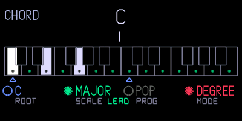

# Changelog

## 3.2.1

- ENTE's attack works. It used to duck at once whatever the attack was set to, which clicked on every kick. Now the attack sets how fast the ducking comes in, from 0.1 to 50 ms. Sounds with a slow attack may duck a little deeper than before.

## 3.2

New synths:

- VOX: your voice, played on the keys. Sing or talk into the OP–1, hold a chord, and VOX puts your words on those notes. Formant makes your voice bigger or smaller without touching the pitch. (Hundekraft)
- SNAP: pitch correction, from polite to obvious. Turn it down and a shaky note slides into tune; turn it up and every note snaps hard to the key. Hold keys and each one adds another copy of your voice, so one chord makes a small choir. (Hundekraft)
- STRUM: a real acoustic guitar that plays along. A Martin HD28, recorded note by note, strums the right chord for your key in time with the tempo. 28 patterns, from campfire strumming and funk to Travis picking, bossa nova and flamenco. (Hundekraft; guitar samples by Jeff Learman)
- REACTOR: a power plant you play like a synth. Four rods hum in a loop that feeds itself; turn up the heat and it grows, bends and howls, and if the heat wins, the core goes critical. (Hundekraft)
- MOAI: a Minimoog-style synth with 121 sounds. Three oscillators into a ladder filter, for fat basses, singing leads and brassy stabs. (fungiboletus)

New effects:

- RACKVERB: the late-80s studio rack in one effect. Big halls, gated drum rooms, reverse reverbs, flangers and slapback echoes, plus QUAD, a multi-effect that chains EQ, chorus, a rotating speaker, delay and reverb. 316 programs, and an AUTH mode with the grainy sound of the original units. (Hundekraft)
- ENTE: the pump, without the patch cables. It ducks your synth every time the kick hits, from a tape track, the input or a steady beat. A rubber duck on screen gets squashed with every hit. (op1r)

New sequencers and tools:

- COMPOSER: hold a key, get a whole song. Verse, chorus and bridge with proper chord changes, in 32 styles from deep house and drum & bass to bossa nova and film noir. Load it on the drum page too and it plays the drums for the same song, with a groove of its own for every style. Hold Shift for swing, note length, a section lock and jumps between sections. (Hundekraft)
- HOLD: hold keys, get a loop. Every key you hold is written into the loop as it passes: a chord, a line, or a drone that never retriggers. Let go and it keeps playing. (Hundekraft)
- TRAIL: a melody that slowly wanders off. Hold a note and it plays a short phrase in your scale built around one small idea, then develops it while you play over it: moved up a step, turned upside down, played backwards. Character takes it from calm to restless, and Answer turns it into a call-and-response partner that replies to what you play. (Hundekraft)
- Latch keeps notes sounding after you let go. (Hundekraft)
- Line clock follows a pulse on the line-in jack, so the OP–1 can play in time with a modular or a drum machine. (Hundekraft, after Pulse Sync by Volker Junginger / ESC_CODE)
  Careful with modular gear: Eurorack clock and gate outputs are often 5 to 10 V, far hotter than the line input is made for, and can damage it. Use an attenuator or a line-level clock output, and start with the level turned down.
- Master LFO gives you four LFOs that move the master effect's knobs. (Hundekraft, op1r)

Better sound:

- Synth voices run at the speed they were designed for. Parts of 28 synths and effects ran too fast or an octave high; they're right now. Sounds saved with them can change.
- MONOLIT has a new ladder filter, a wider Contour, and Heat that makes the filter sing on its own. Saved MONOLIT sounds can change.
- Every effect starts with only a little effect, so you can scroll through them while you play.
- Input gain for VOX, SNAP and AMP: turn blue on T2 to lift a quiet mic or tame a hot line, from −12 to +24 dB. It's saved for each input.

Playing:

- Chord strums can be much slower, up to half a beat between notes, with Human and Shape on page B.
- The scale view looks like the chord page and shows what each key plays.
- Sampler: Shift + green tunes a sample to its own pitch, and the drum auto-cut is easier to set.
- TAPE has a second page: more play heads (2, 3, dotted or swing), a dry/wet mix, and echoes locked to the tempo from 1/16 to 1/2. Older tape sounds play as before. (op1r)
- The quad LFO gets two chaotic waves, Lorenz x and Lorenz z, and a new LFO type, POND: four species compete in a pond, and their ups and downs move four targets. (op1r)
- Chord mode now has 69 progressions in seven groups (pop, rock, jazz, classic, bass lines, film and world), from La Folia and Pachelbel's canon with its walking bass to Giant Steps and Just the Two of Us. Chords can have their own bass note, as slash chords like G/B, and the bass line walks as written. Shift + white jumps from group to group. (Hundekraft)
- BLOT gets a truer 303 squelch: the filter now follows the TB-303's own, the bass holds steady under the resonance, and accents fade with the decay knob. (op1r)
- A metronome that doesn't clash with your tape: pick TICK, a short tick with no pitch, or WOOD, a woodblock knock, in place of the OP-1's beep. It's on the settings page (Shift + help, then T3), on the orange encoder. (Hundekraft)
- C64ARP has eight more tables: OCTAVE, SUS2, DOM7, DIM7, AUG, ADD9, MIN9 and ALBERTI, a broken chord like a piano's left hand. It can also play the keys you hold in random order: turn blue right past the last table to RANDOM.
- MIDI: separate channels for the keys and for knob changes, knob positions sent back to your controller, and the mixer reachable over MIDI. (op1r)
- FX2 routing works with every master effect, the stock ones too, and a track with its send at 0 stays dry. (op1r, Hundekraft)

Fixes:

- TOMBOLA's balls no longer escape the hexagon and go quiet when you switch between screens, for example with FATHER on the master.
- STUTTER's slices have the right length again.
- SID's interval in sync and ring mode steps in semitones, +0 to +24, so it's easy to set and always in tune. Saved sounds keep their interval.
- Sequencers play drum pads at the pad's own pitch. Euclid, Grids, Dots, COMPOSER and HOLD played each pad sharp, more the further right it sat: the eighth key from the left came out a fifth up.
- Notes from a MIDI keyboard are recorded at the pitch you play, also with the OP-1's octave shifted. Dots, Euclid, Oracle, Peal, Grids, HOLD, TRAIL and C64ARP put them an octave off.

## 3.1.4

- Easier updates. From now on, updates over USB no longer need the op1_246.op1 file, only your OP–1 and a cable. You’ll need the file once more to install 3.1.4 itself.

## 3.1.3

- Fixed clicks and short dropouts in tape recordings, most often in the first 20 seconds of a take or in audio copied to the start of the tape. It mostly happened on units with fragmented or nearly full flash, where saving to flash is slow. The cause was a bug in the original 246 firmware, which can drop recorded audio that hasn't been saved yet, made worse by our tape undo's own flash writes.

## 3.1.2

- Oxbow shows its controls again: each encoder's name and value along the bottom, with its page-2 control beneath, and the art raised above them.
- Sampler+: cutoff and resonance (T2 + Shift) now work straight away; turning them switches the filter on as low-pass.
- Fixed knobs that stopped responding after using the sample editor or a second knob page, then switching sounds.
- Lighter screens for C64arp, Warble and Pew, so every plugin fits again.

## 3.1.1

- Fixed a crash (“out of memory”) when switching screens with a sequencer running, most often with many plugins and presets installed. The OP–1 now has more room for drawing its screens.
- The workshop tells you when a selection is too much for the OP–1 to hold, and won’t build or send it until you untick a plugin or two.

## 3.1

Install the full firmware once (boot menu or the workshop’s full update) and back up your tapes and sounds first. After that, updates go over USB.

New synths and effects:

- MONOLIT, a ladder-filter synth for bass and leads (Hundekraft)
- JUNI and JUNI chorus, an early-80s polysynth and its chorus (Hundekraft)
- SISTER, a cathedral reverb whose tail sings (Hundekraft)
- outatime, a time-travel synth (LizardMan245)
- Bloodmoon, a gothic organ with a haunted bell (Nola Drift / SammiBabe666)
- Hollow Saint, a haunted hurdy-gurdy (SammiBabe666)
- From op1r: Grids and dddd, Steve and blot (pcppcp), Brassophone (nvmsocool), Nostromo (Lewis-Clayton), VAPORA (AiAAAA)

New features:

- Master effect routing, Dots synth locks, Sampler+ play modes (pcppcp, Anthony Berg / op1r)
- Chord mode page B and more scales and key maps (pcppcp / op1r, Hundekraft)
- Amp, a live-input amp with a tuner, and new Resource monitor pages (Hundekraft)
- Presets use the new effects and LFOs more, and the workshop offers a matching preset pack for any selection

Faster and steadier:

- Plugins run from faster memory, so big chords on heavy sounds stay clean
- Many synths and effects need much less CPU and sound the same
- Recording to tape no longer slows the OP-1 (after op1r)
- Fewer save stalls when you turn knobs (pcppcp / op1r)

Changed:

- New screens for Wavetable, JUNI, JUNI chorus and Taffy
- Pew is redesigned with 16 new presets; older Pew sounds play differently
- Father is rebuilt and lighter, with a slightly darker tail
- The Lander game is gone; its memory now speeds up the plugins

Fixes: disk mode ends on eject again, tape recording stops cleanly when flash runs low, room for 63 sampler sounds (move extras past 33 off before going back to 3.0.3), no stuck notes in scale and chord mode, and fixes for Gin, Trail and the sampler tools.

## 3.0.3

- Oxbow: larger two-line control names and values, with the artwork raised to make room. (Hundekraft, based on zvenson’s OberVave)
- C64 arpeggiator: turn orange right to hold notes, like the stock arpeggio; Gate moves to Shift + orange. Turn blue left past Major for TABLE OFF, which plays only the keys you hold. (Hundekraft)

## 3.0.2

- Clouds: reduced processing load for dense textures while preserving the sound, grain count and reverb quality. (Hundekraft optimization; pcppcp / op1r fixed-point port; Mutable Instruments DSP by Émilie Gillet)
- C64 arpeggiator: reduced gate-timing processing overhead without changing note timing. (Hundekraft)

## 3.0.1

- Amp: new optional live-input engine with Volume, Comp, Tone and Drive, plus a T2 tuner. (Hundekraft; workflow inspired by Teenage Engineering’s OP-1 Field)
- EVA: restored the radio beep’s level while keeping the choir level unchanged. (Hundekraft)
- Oxbow: reduced synthesis processing cost and improved arithmetic safety at high resonance; added active control names and values for Cutoff, Env and the pushed Wave, Filter and Drive controls. (Hundekraft, based on zvenson’s OberVave)

## 3.0

New since 2.7.2; earlier features remain included.

- Kennel core: synths, effects and optional tools load from individual plugin files. Every build supports 300 user synth presets. (Hundekraft, built from pcppcp’s op1r)
- EVA: space choir and radio interference, with a key-tracking beep and an orange-push octave selector. (Hundekraft)
- MBIRA: thumb-piano synthesis. (Hundekraft)
- Oxbow: OB-style polysynth with normal OP-1 presets. (Hundekraft, based on zvenson’s OberVave)
- SID: 8580-inspired chip synth. (Hundekraft, based on Hermit’s cRSID)
- Aether: control pitch and volume by tilting the OP-1. (pcppcp / op1r; artwork by DAN76/Rackes)
- Gin: drum synthesis with 24 sounds per kit, A/B morphing, four voices, a full editor and eight factory kits. (SquareWave Studio; libpo32 by Eric Lewis; kits adapted from CNTR RNDM)
- HAIL: granular clouds with secondary controls shown on screen. (Hundekraft, based on Émilie Gillet’s Mutable Instruments Beads)
- STUTTER: beat-synchronised stuttering. (Hundekraft)
- Father: stereo ambience reverb with an optional gate. (Hundekraft DSP; Father concept and visual reference by Reddit creator xylograph)
- Crush, Warble and Plate: distortion, modulation and reverb rebuilt as native plugins. (Maiko Pruett’s designs; Hundekraft implementation)
- C64 arpeggiator: editable pitch tables, per-step dwell and gate. (Hundekraft)
- Randomiser: create sound variations and restore up to six earlier states. (Lewis-Clayton / pcppcp; native port by Hundekraft)
- MIDI Tape: record notes and CCs on four tracks alongside the tape, with first-note auto-start, MIDI-only count-in and take/selection quantisation. CC automation also controls the synth’s knobs. (pcppcp / op1r; native integration by Hundekraft)
- Sampler+: loop crossfades, ping-pong, pitch envelopes, filtering, sync and a sample browser. (pcppcp / op1r)
- Four tapes, each with its own tracks, loop, tempo and album; live merge, loop copy/paste and bounce; seven-step undo with a popup. (Maiko Pruett’s designs; Hundekraft implementation)
- Sampler tools: zoom, tuner with retune, and fitting samples to 1–8 bars. (Maiko Pruett’s designs; Hundekraft implementation)
- FILE and flash check rebuilt for kennel. Recording now uses a stable audio copy to prevent healthy flash blocks being wrongly retired; previously marked blocks remain reserved. (Maiko Pruett’s tool designs; Hundekraft implementation and recording fix)
- Clouds processing improvements, more Reverb headroom, In a room loop crossfades and detailed audio-load monitoring. (pcppcp / op1r; In a room by ultralazr; Mutable Instruments DSP by Émilie Gillet)
- 152 curated synth presets, filtered to your selected engines and effects, with revised sound, envelope, FX and LFO settings. Gin’s kits are separate. (Hundekraft; credited source engines and effects)
- One Update OP–1 flow: review installs, replacements, removals and conflicts; send changed plugins over USB, or include a full firmware upgrade when the core needs updating. First installation still uses the boot menu. (Hundekraft)
- Your own plugins: install .knl or .op1p files, manage saved uploads and installed imports in the same list, and Remove or Undo before sending. Choices and uploaded files persist in this browser. Restart verification checks what actually installed. (Hundekraft)
- Updated manual with readable selection links, current feature screenshots and a guide to building and distributing standalone .knl plugins. Short firmware filenames keep the full configuration ID in the build report. (Hundekraft)
- Lander is an optional full-firmware choice, off by default. (Teenage Engineering game; workshop option by Hundekraft)
- Fixed shared-screen graphics-memory exhaustion when changing sound slots and views; reduced heavy-screen drawing work. Plugin loading checks skip invalid files and preserve a recovery route. (Hundekraft)

## 2.7.2

- Fixed: the OP-1 could stop on an error screen at start-up ("Invalid drum patch … error 12"). In drum+, switching a pad back to gate saved a value the OP-1's own check rejects, so the kit failed to load on the next start. Gate is now saved with a value it accepts, and kits saved with 2.6 to 2.7.1 load again, still on gate.
- Fixed: a sound with an effect or LFO the OP-1 doesn't know no longer stops it on an error screen ("Invalid synth patch … error 22"). An unknown effect plays as the filter and keeps its name, so it comes back on a build that has that effect. If the sound still won't load, its effect and LFO are set to delay and element, both off.
- Stuck on the error screen? Hold COM while you switch the OP-1 on, choose firmware update and install 2.7.2. Your tapes, album and presets stay where they are.

## 2.7.1

- Musica Obscura now comes straight from op1r, which merged ultralazr's modules into its own source, together with op1r's small fixes since then. Everything sounds and works the same.

## 2.7

- New: chord mode. Every key you play becomes a chord in the key and scale you choose, on any synth. It stays off until you switch it on.
  - Open it on the clock screen: press Shift + help, then T4. Press T4 again to close the page.
  - Orange: push to switch chords on or off, turn to choose degree or step mode.
  - Degree mode: each key plays the chord that belongs to it in your scale. Hold Shift for a dominant 7th on that key instead.
  - Step mode: each key press plays the next chord of a progression, and the key you press sets how high it sounds. Shift + a key steps back.
  - Blue: turn to set the root note, push to change the chord colour in degree mode (triad, sus4, sus2, 7th, add9).
  - Green: turn to pick one of 13 scales. Push to choose what out-of-scale keys play: a leading chord into the next scale chord, a passing diminished chord or a borrowed chord. Shift + push switches voice leading on or off.
  - White: turn to pick one of 16 progressions or your own. To record your own, push white in degree mode, play up to 16 chords and push again; it becomes "mine". In degree mode, Shift + push clears it. In step mode, push to start the progression over.
  - Your settings are kept after a restart. MIDI out still sends only the key you pressed.
  - With Maiko's scale mode on, keys snap to the scale before chord mode sees them, so out-of-scale chords don't play.

  
- New: Musica Obscura by ultralazr. Mixtur is a subharmonic organ after Oskar Sala's Mixtur-Trautonium, Arc is Duddell's singing arc lamp from 1899, Palme adds the sympathetic strings of the Ondes Martenot, and In a room loops your sound through a room, like Alvin Lucier's piece. Oracle and Peal are sequencers based on geomancy and English bell ringing. Untick any of the four sounds you don't want in your OP-1's lists.
- Supersaw and FM Bell are 6 dB quieter, like Wavetable and Taffy in 2.6.2, so chords no longer clip the synth mix. Turn the volume up a little if you want the old level back.

## 2.6.2

- Wavetable and Taffy are quieter, so chords no longer crackle. They were louder than the OP-1's own synths, and pads with five or more notes clipped the synth mix. Turn the volume up a little if you want the old level back.

## 2.6.1

- Fixed: builds without all four Hundekraft synths and both effects froze on the boot screen. Every combination boots now.
- Stuck on the boot screen? Hold COM while you switch the OP-1 on, choose firmware update and install a new build. Your tapes, album and presets stay where they are.

## 2.6

- Base updated to op1r 30. The big addition is drum+: per-pad envelope, pitch envelope, retrig, choke, filter, drive and velocity routing on top of a stock drum kit. In drum mode, press Shift + T1 and pick DRUM+. op1r 28–30 also bring loop points, volume and fade curves to the sample editor, equal slices in auto-cut, and a much faster tape erase.
- Elg and Washer now use about half the CPU they did, Wavetable about a third less, and Snowglobe less too. They sound the same.
- Elg no longer bursts into harsh noise with the white knob high on high notes.
- Maiko's tape undo still works with the faster tape erase.

## 2.5

- Base updated to op1r 27. Our synths and effects are now built into op1r's own engine system.
- Pick which of op1r's synths and effects to include: Supersaw, FM Bell, Granular, Tape, Clouds and Reverb.
- New screens for Wavetable, Taffy, PEW, Elg, Washer and Snowglobe.
- Quad LFO no longer crackles next to heavy effects like Reverb and Snowglobe.
- Washer's white knob now shortens the delay smoothly across its whole range. Before, the upper half jumped.

## 2.1

- Fixes crashes in Dots (press REC, then add a note) and Euclid (hold Shift and press note keys). The OP-1 keeps settings, sounds and sequences in an SQLite database with a fixed amount of working memory. With a lot of saved sounds and sequences, that memory could fill up and the firmware stopped on an error screen. 2.1 limits how much of the database is kept in memory.
- Knobs on Wavetable, Taffy, PEW and Elg are smoother. Turning one while notes play no longer clicks or steps.

## 2.0

- Base updated to op1r 22.
- Adds Maiko's #249 toolkit (tape undo/redo, snapshot naming, scale mode, storage overview), optional and on by default.

## 1.0

- First release, on op1r 18.
- Hundekraft synths (Wavetable, Taffy, PEW, Elg) and effects (Washer, Snowglobe), plus a choice of 100 or 300 user presets.
- A matching collection of up to 112 presets.
