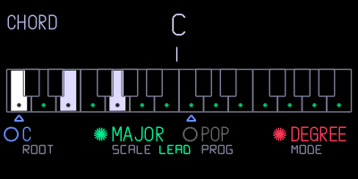

# Changelog

## 3.0

New since 2.7.2; earlier features remain included.

- Kennel core: synths, effects and optional tools load from individual plugin files. Every build supports 300 user synth presets. (Hundekraft, built from pcppcp’s op1r)
- EVA: space choir and radio interference, with a key-tracking beep and an orange-push octave selector. (Hundekraft)
- MBIRA: thumb-piano synthesis. (Hundekraft)
- Oxbow: OB-style polysynth with normal OP-1 presets. (Hundekraft, based on zvenson’s OberVave)
- SID: 8580-inspired chip synth. (Hundekraft, based on Hermit’s cRSID)
- Aether: control pitch and volume by tilting the OP-1. (pcppcp / op1r)
- Gin: drum synthesis with 24 sounds per kit, A/B morphing, four voices, a full editor and eight factory kits. (SquareWave Studio; libpo32 by Eric Lewis; kits adapted from CNTR RNDM)
- HAIL: granular clouds with secondary controls shown on screen. (Hundekraft, based on Émilie Gillet’s Mutable Instruments Beads)
- STUTTER: beat-synchronised stuttering. (Hundekraft)
- Father: stereo ambience reverb with an optional gate. (Hundekraft)
- Crush, Warble and Plate: distortion, modulation and reverb rebuilt as native plugins. (Maiko Pruett’s designs; Hundekraft implementation)
- C64 arpeggiator: editable pitch tables, per-step dwell and gate. (Hundekraft)
- Randomiser: create sound variations and restore up to six earlier states. (Lewis-Clayton / pcppcp; native port by Hundekraft)
- MIDI Tape: record notes and CCs on four tracks alongside the tape, with first-note auto-start, MIDI-only count-in and take/selection quantisation. CC automation also controls the synth’s knobs. (pcppcp / op1r; native integration by Hundekraft)
- Sampler+: loop crossfades, ping-pong, pitch envelopes, filtering, sync and a sample browser. (pcppcp / op1r)
- Four tapes, each with its own tracks, loop, tempo and album; live merge, loop copy/paste and bounce; seven-step undo with a popup. (Maiko Pruett’s designs; Hundekraft implementation)
- Sampler tools: zoom, tuner with retune, and fitting samples to 1–8 bars. (Maiko Pruett’s designs; Hundekraft implementation)
- FILE and flash check rebuilt for kennel. Recording now uses a stable audio copy to prevent healthy flash blocks being wrongly retired; previously marked blocks remain reserved. (Maiko Pruett’s tool designs; Hundekraft implementation and recording fix)
- Clouds processing improvements, more Reverb headroom, In a room loop crossfades and detailed audio-load monitoring. (pcppcp / op1r; In a room by ultralazr; Mutable Instruments DSP by Émilie Gillet)
- 152 curated synth presets, filtered to your selected engines and effects, with revised sound, envelope, FX and LFO settings. Gin’s kits are separate. (Hundekraft; credited source engines and effects)
- One Update OP–1 flow: review installs, replacements, removals and conflicts; send changed plugins over USB, or include a full firmware upgrade when the core needs updating. First installation still uses the boot menu. (Hundekraft)
- Your own plugins: install .knl or .op1p files, manage saved uploads and installed imports in the same list, and Remove or Undo before sending. Choices and uploaded files persist in this browser. Restart verification checks what actually installed. (Hundekraft)
- Updated manual with readable selection links, current feature screenshots and a guide to building and distributing standalone .knl plugins. Short firmware filenames keep the full configuration ID in the build report. (Hundekraft)
- Lander is an optional full-firmware choice, off by default. (Teenage Engineering game; workshop option by Hundekraft)
- Fixed shared-screen graphics-memory exhaustion when changing sound slots and views; reduced heavy-screen drawing work. Plugin loading checks skip invalid files and preserve a recovery route. (Hundekraft)

## 2.7.2

- Fixed: the OP-1 could stop on an error screen at start-up ("Invalid drum patch … error 12"). In drum+, switching a pad back to gate saved a value the OP-1's own check rejects, so the kit failed to load on the next start. Gate is now saved with a value it accepts, and kits saved with 2.6 to 2.7.1 load again, still on gate.
- Fixed: a sound with an effect or LFO the OP-1 doesn't know no longer stops it on an error screen ("Invalid synth patch … error 22"). An unknown effect plays as the filter and keeps its name, so it comes back on a build that has that effect. If the sound still won't load, its effect and LFO are set to delay and element, both off.
- Stuck on the error screen? Hold COM while you switch the OP-1 on, choose firmware update and install 2.7.2. Your tapes, album and presets stay where they are.

## 2.7.1

- Musica Obscura now comes straight from op1r, which merged ultralazr's modules into its own source, together with op1r's small fixes since then. Everything sounds and works the same.

## 2.7

- New: chord mode. Every key you play becomes a chord in the key and scale you choose, on any synth. It stays off until you switch it on.
  - Open it on the clock screen: press Shift + help, then T4. Press T4 again to close the page.
  - Orange: push to switch chords on or off, turn to choose degree or step mode.
  - Degree mode: each key plays the chord that belongs to it in your scale. Hold Shift for a dominant 7th on that key instead.
  - Step mode: each key press plays the next chord of a progression, and the key you press sets how high it sounds. Shift + a key steps back.
  - Blue: turn to set the root note, push to change the chord colour in degree mode (triad, sus4, sus2, 7th, add9).
  - Green: turn to pick one of 13 scales. Push to choose what out-of-scale keys play: a leading chord into the next scale chord, a passing diminished chord or a borrowed chord. Shift + push switches voice leading on or off.
  - White: turn to pick one of 16 progressions or your own. To record your own, push white in degree mode, play up to 16 chords and push again; it becomes "mine". In degree mode, Shift + push clears it. In step mode, push to start the progression over.
  - Your settings are kept after a restart. MIDI out still sends only the key you pressed.
  - With Maiko's scale mode on, keys snap to the scale before chord mode sees them, so out-of-scale chords don't play.

  
- New: Musica Obscura by ultralazr. Mixtur is a subharmonic organ after Oskar Sala's Mixtur-Trautonium, Arc is Duddell's singing arc lamp from 1899, Palme adds the sympathetic strings of the Ondes Martenot, and In a room loops your sound through a room, like Alvin Lucier's piece. Oracle and Peal are sequencers based on geomancy and English bell ringing. Untick any of the four sounds you don't want in your OP-1's lists.
- Supersaw and FM Bell are 6 dB quieter, like Wavetable and Taffy in 2.6.2, so chords no longer clip the synth mix. Turn the volume up a little if you want the old level back.

## 2.6.2

- Wavetable and Taffy are quieter, so chords no longer crackle. They were louder than the OP-1's own synths, and pads with five or more notes clipped the synth mix. Turn the volume up a little if you want the old level back.

## 2.6.1

- Fixed: builds without all four Hundekraft synths and both effects froze on the boot screen. Every combination boots now.
- Stuck on the boot screen? Hold COM while you switch the OP-1 on, choose firmware update and install a new build. Your tapes, album and presets stay where they are.

## 2.6

- Base updated to op1r 30. The big addition is drum+: per-pad envelope, pitch envelope, retrig, choke, filter, drive and velocity routing on top of a stock drum kit. In drum mode, press Shift + T1 and pick DRUM+. op1r 28–30 also bring loop points, volume and fade curves to the sample editor, equal slices in auto-cut, and a much faster tape erase.
- Elg and Washer now use about half the CPU they did, Wavetable about a third less, and Snowglobe less too. They sound the same.
- Elg no longer bursts into harsh noise with the white knob high on high notes.
- Maiko's tape undo still works with the faster tape erase.

## 2.5

- Base updated to op1r 27. Our synths and effects are now built into op1r's own engine system.
- Pick which of op1r's synths and effects to include: Supersaw, FM Bell, Granular, Tape, Clouds and Reverb.
- New screens for Wavetable, Taffy, PEW, Elg, Washer and Snowglobe.
- Quad LFO no longer crackles next to heavy effects like Reverb and Snowglobe.
- Washer's white knob now shortens the delay smoothly across its whole range. Before, the upper half jumped.

## 2.1

- Fixes crashes in Dots (press REC, then add a note) and Euclid (hold Shift and press note keys). The OP-1 keeps settings, sounds and sequences in an SQLite database with a fixed amount of working memory. With a lot of saved sounds and sequences, that memory could fill up and the firmware stopped on an error screen. 2.1 limits how much of the database is kept in memory.
- Knobs on Wavetable, Taffy, PEW and Elg are smoother. Turning one while notes play no longer clicks or steps.

## 2.0

- Base updated to op1r 22.
- Adds Maiko's #249 toolkit (tape undo/redo, snapshot naming, scale mode, storage overview), optional and on by default.

## 1.0

- First release, on op1r 18.
- Hundekraft synths (Wavetable, Taffy, PEW, Elg) and effects (Washer, Snowglobe), plus a choice of 100 or 300 user presets.
- A matching collection of up to 112 presets.
